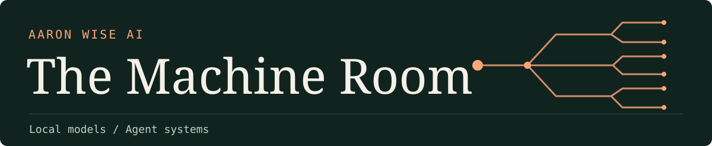

# Aaron Wise

I build agents for the work that comes around every week. A reporting agent can gather the numbers for a Monday brief. A support agent can draft replies and leave them for someone who knows the customer to review.

[Visit my workbench](https://aaronwiseai.com/) · [LinkedIn](https://www.linkedin.com/in/aaron-wise-31b00349/) · [Email me](mailto:aaronwise@aaronwiseai.com)

## Selected work

| Project | What you can do |
| :--- | :--- |
| [WiseAI Harness](https://harness.aaronwiseai.com/) | Give an agent a job, connect its tools, and choose which results need your approval. |
| [WiseBench Community](https://wisebench.aaronwiseai.com/) | Run the same tasks on two local models and inspect where each one missed an instruction. |
| [Toknado](https://toknado.aaronwiseai.com/) | Connect an OpenAI-compatible app to a managed model pool and check its usage. |

**On my bench** · I’m building Wise Decisions to take a repeat-customer campaign from audience selection through the follow-up email. [See the development preview](https://aaronwiseai.com/#wise-decisions)

## Inside the machine room

<strong>How I connect a local model to 21 MCP servers</strong>

My LM Studio setup gives one model access to six groups of tools, including search, memory, and publishing. The system map shows which server handles each job and how it connects.

[Explore the system map](https://aaronwiseai.com/aidocs/MCPEcosystem.html)

<strong>How I keep track of 10 Discord agents</strong>

My agents share context across tasks. In the command center I can trace an event back to the agent that handled it and inspect the token use for each model request.

[See the fleet and usage panels](https://aaronwiseai.com/#agent-wiseai)

<strong>How I inspect an OpenClaw skill before installing it</strong>

I built a scanner to help review what a skill asks an agent to do. The prompt-injection defense project covers the related problem of instructions hidden in content the agent reads.

[Inspect the scanner](https://github.com/awiseguy88/Openclaw-skill-scanner) · [Read the defense project](https://github.com/awiseguy88/openclaw-advanced-prompt-injection-defense-system) · [Explore ClawUniverse](https://aaronwiseai.com/clawuniverse/)

## GitHub activity

<!-- METRICS:START -->
[188 indexed public commits](https://github.com/search?q=author%3Aawiseguy88&type=commits) · [16 owned public repositories excluding forks](https://github.com/search?q=user%3Aawiseguy88+fork%3Afalse+is%3Apublic&type=repositories)
<!-- METRICS:END -->
